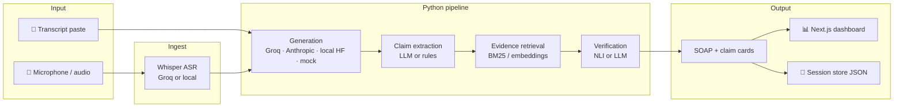
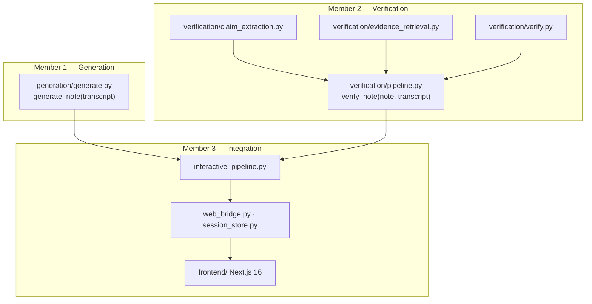
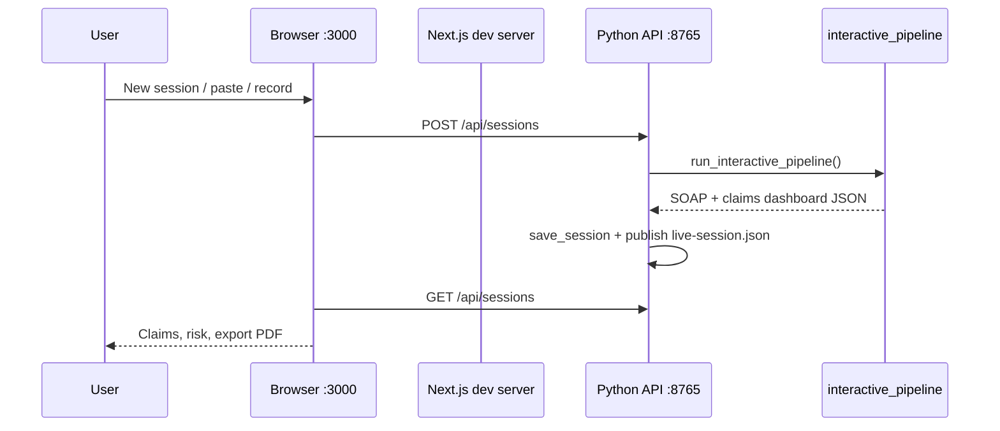

# 🏥 TrustedNote — Grounded Clinical Documentation

[](https://www.python.org/)
[](https://nextjs.org/)
[]()
[](https://console.groq.com/)

**TrustedNote** turns doctor–patient conversations into **SOAP clinical notes** and **audits every atomic claim** against the original transcript — so unsupported or contradicted statements are visible before a note is trusted.

> ⚠️ **Research prototype only.** Outputs require clinician review. This is not FDA-cleared software and must not be used with identifiable patient data without proper authorization.

---

## ✨ Highlights

| Feature | Description |
|--------|-------------|
| 📝 **SOAP generation** | Structured Subjective / Objective / Assessment / Plan from transcript |
| 🔬 **Claim decomposition** | FActScore-style atomic clinical claims per SOAP section |
| 🔍 **Evidence retrieval** | Keyword or dense (MiniLM) windows from the transcript |
| ⚖️ **Three-way verification** | Supported · Contradicted · Unverifiable (NLI or LLM judge) |
| 🖥️ **Live dashboard** | Next.js UI + Python API for sessions, recording, and export |
| 🎙️ **Speech input** | Groq Whisper (or optional local faster-whisper) |
| 📊 **Batch evaluation** | ACI-Bench CSV/JSONL, ROUGE-L, optional BERTScore |
| 🧪 **Offline smoke tests** | `--gen-backend mock` without API keys |

---

## 🏗️ System architecture

### End-to-end data flow



### Process layers (research modules)



### Runtime services (interactive mode)



| Port | Service |
|------|---------|
| **3000** | Next.js dashboard (`frontend/`) |
| **8765** | Python HTTP bridge (`web_bridge.py`) — sessions, transcription, fallback HTML |

---

## 📁 Repository layout

```
TrustedNote/
├── main.py                    # Interactive + batch CLI entry
├── config.py                  # .env-backed settings
├── interactive_pipeline.py    # Shared SOAP + claims pipeline
├── web_bridge.py              # Dashboard bootstrap + REST API
├── session_store.py           # Persist sessions under data/sessions/
├── transcription.py           # Groq Whisper / local ASR
├── generation/                # SOAP note generation backends
├── verification/              # Claims, retrieval, NLI/LLM verify
├── trustnote/                 # Research CLI package (pip install -e .)
├── frontend/                  # Next.js dashboard
├── data/
│   ├── aci-bench-corpus/      # Bundled ACI-Bench (research)
│   └── prepared/              # train / valid / test JSONL splits
├── docs/                      # EXPERIMENT_PLAN, METHODS, VALIDATION
├── examples/                  # Sample transcript + error note
├── tests/                     # Unit tests
├── requirements.txt           # Pip deps for main.py path
├── pyproject.toml             # Editable trustnote package
├── .env.example               # Copy to .env — never commit secrets
└── Instructions.txt           # Quick local cheat sheet
```

---

## 🚀 Quick start (Windows)

### Prerequisites

- **Python 3.10+** (3.11 recommended)
- **Node.js 18+**
- **Groq API key** — [console.groq.com](https://console.groq.com/)
- Optional: **GPU / RAM** for local NLI (`sentence-transformers`, `transformers`)

### 1️⃣ Clone & configure

```powershell
git clone https://github.com/Adityavasudev2006/TrustedNote.git
cd TrustedNote
copy .env.example .env
# Edit .env and set GROQ_API_KEY=your_key_here
```

### 2️⃣ Python environment

```powershell
py -3.11 -m venv .venv
.\.venv\Scripts\python.exe -m pip install --upgrade pip
.\.venv\Scripts\python.exe -m pip install -r requirements.txt
.\.venv\Scripts\python.exe -m pip install -e .
.\.venv\Scripts\python.exe -m pip install -e ".[ml]"    # NLI + dense retrieval
```

Download spaCy model (batch metrics / NLP utilities):

```powershell
.\.venv\Scripts\python.exe -m spacy download en_core_web_sm
```

### 3️⃣ Frontend

```powershell
cd frontend
npm install
cd ..
```

### 4️⃣ Run with dashboard 🖥️

```powershell
.\.venv\Scripts\python.exe main.py
```

1. Browser opens **http://127.0.0.1:3000** (or use the URL printed in the terminal).
2. **Sessions → New session** — paste a transcript **or** **Start recording** (allow microphone).
3. Keep **`main.py` running** — the API on **8765** powers the UI.
4. Fallback viewer (no Next.js): **http://127.0.0.1:8765/**

Terminal mode: paste conversation text, then type **`END`** on its own line.

### Headless / no browser

```powershell
.\.venv\Scripts\python.exe main.py --no-ui --gen-backend mock
```

---

## 🎛️ CLI reference

### `main.py` (interactive + ACI-Bench batch)

| Flag | Description |
|------|-------------|
| `--gen-backend` | `groq` · `anthropic` · `local_hf` · `mock` |
| `--verify-mode` | `nli` (local DeBERTa) · `llm` (API judge) |
| `--dense` | Semantic embedding retrieval (downloads MiniLM) |
| `--soap-only` | Skip claim verification |
| `--no-ui` | Do not start Next.js / API |
| `--csv PATH --n 20` | Batch evaluation on ACI-Bench-style CSV |

```powershell
.\.venv\Scripts\python.exe main.py --csv data\aci-bench\valid.csv --n 3 --gen-backend groq --verify-mode nli
```

### `python -m trustnote` (research reports)

See **[GROQ_START.md](GROQ_START.md)** for Groq structured-output runs and **[START_HERE.md](START_HERE.md)** for Gemini + prepared ACI splits.

```powershell
.\.venv\Scripts\python.exe -m trustnote run --transcript examples\transcript.txt --out outputs\first
.\.venv\Scripts\python.exe -m trustnote batch --data data\prepared\valid.jsonl --limit 3 --out outputs\valid3
```

---

## 🔐 Environment variables

Copy **[`.env.example`](.env.example)** → **`.env`**. Important keys:

| Variable | Purpose |
|----------|---------|
| `GROQ_API_KEY` | Generation + Whisper transcription |
| `GROQ_MODEL` | Default `openai/gpt-oss-20b` |
| `GROQ_REQUEST_INTERVAL` | Seconds between Groq calls (rate limits) |
| `TRUSTNOTE_GEN_BACKEND` | Default generation backend |
| `TRUSTNOTE_VERIFY_MODE` | `nli` or `llm` |
| `TRUSTNOTE_EMBED_MODEL` | Sentence-transformer for `--dense` |
| `ANTHROPIC_API_KEY` | Optional Claude backend |

Never commit `.env` — it is listed in **`.gitignore`**.

---

## 🧠 Verification pipeline (conceptual)

1. **Generate** SOAP note from transcript only (no reference note leakage).
2. **Extract** atomic claims per SOAP section (LLM or rule fallback).
3. **Retrieve** top-k transcript spans per claim.
4. **Classify** each claim: **Supported** / **Contradicted** / **Unverifiable**.
5. **Publish** results to terminal, JSON session files, and the dashboard.

Inspired by **FActScore**-style decomposition, **AlignScore**-like alignment (implemented with off-the-shelf NLI), and **VERISCORE**-style LLM verification when `--verify-mode llm`.

Deep dive: [`docs/METHODS.md`](docs/METHODS.md) · [`docs/VALIDATION.md`](docs/VALIDATION.md) · [`docs/EXPERIMENT_PLAN.md`](docs/EXPERIMENT_PLAN.md)

---

## 🧪 Tests

```powershell
.\.venv\Scripts\python.exe -m unittest discover -s tests -v
```

---

## 🛠️ Troubleshooting

| Issue | Fix |
|-------|-----|
| `GROQ_API_KEY is not set` | Fill `.env` or use `--gen-backend mock` |
| Dashboard empty / fetch errors | Keep `main.py` running; check port **8765** |
| Node not found | Install Node 18+; run `npm install` in `frontend/` |
| Slow first NLI run | Models download on first use; use keyword retrieval without `--dense` |
| Groq rate limits | Increase `GROQ_REQUEST_INTERVAL`; shorten transcript |
| Mic / transcription fails | Set `GROQ_API_KEY`; allow browser microphone |

---

## 👥 Team ownership (course / research)

| Area | Modules |
|------|---------|
| **Generation** | `generation/`, `trustnote/generation.py` |
| **Verification & metrics** | `verification/`, `evaluation/`, `trustnote/verification.py` |
| **Product / integration** | `main.py`, `web_bridge.py`, `frontend/` |

---

## 📜 Data & ethics

- Bundled **ACI-Bench** material is for **research**; respect original licenses and citations.
- Do not upload **PHI** to Groq, Anthropic, or Gemini without institutional approval.
- Model-estimated “unsupported claim rate” is **not** clinical ground truth — use human annotation (`annotations.csv` workflow in the research CLI).

---

## 🔗 Links

- **Repository:** [github.com/Adityavasudev2006/TrustedNote](https://github.com/Adityavasudev2006/TrustedNote)
- **Groq docs:** [console.groq.com/docs](https://console.groq.com/docs)
- **Related guides:** [GROQ_START.md](GROQ_START.md) · [START_HERE.md](START_HERE.md) · [Instructions.txt](Instructions.txt)

---

<p align="center">
  Built with ❤️ for trustworthy clinical AI research · <strong>Trust, but verify every claim.</strong> ✅
</p>
